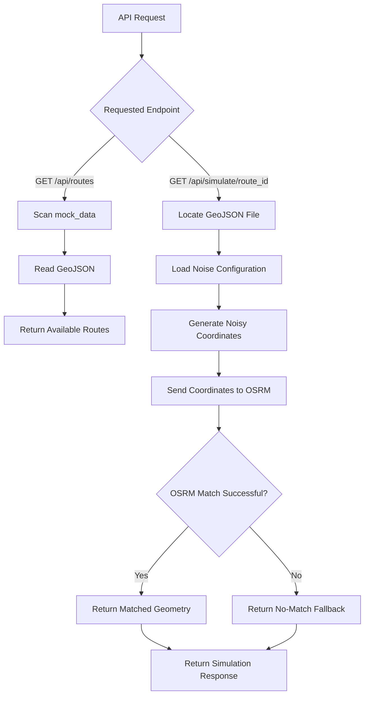
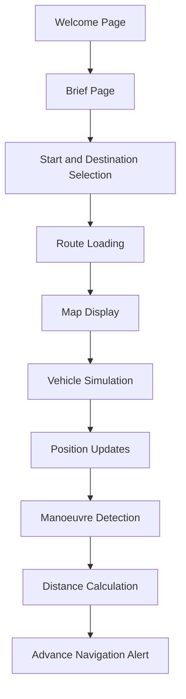

# where to PARTH — Architecture

## 1. Purpose

This document describes the existing backend architecture and the intended product workflow.

It distinguishes existing implementation from planned frontend and navigation capabilities.

It does not introduce any new architectural decisions.

## 2. Current Repository Structure

```text
wheretoPARTH/
│
├── main.py
├── noise_config.json
├── requirements.txt
│
├── mock_data/
│   ├── route_exit_A.geojson
│   └── return_route.geojson
│
└── README.md
```

## 3. Current Backend Components

| Component | Technology/File | Responsibility |
|---|---|---|
| API application | FastAPI | Exposes application endpoints |
| GeoJSON loader | Python | Reads route geometries |
| Noise generator | NumPy/Python | Generates inaccurate coordinates |
| Configuration | JSON | Stores noise parameters |
| Routing/matching | OSRM API | Matches location traces to road geometry |
| HTTP communication | HTTPX | Communicates with OSRM |
| Data validation | Pydantic | Defines API response models |
| Route storage | GeoJSON files | Stores predefined routes |

## 4. Current Backend Architecture



## 5. Current API Endpoints

### GET `/api/routes`

Scans the `mock_data/` directory for GeoJSON files.

Returns:
- Route ID.
- Starting coordinate.
- Ending coordinate.

Coordinates use the format:

`[longitude, latitude]`

### GET `/api/simulate/{route_id}`

Accepts a route identifier, with or without the `.geojson` extension.

Processing:

1. Locate the requested GeoJSON file.
2. Load the noise configuration.
3. Extract route coordinates.
4. Generate noisy coordinates.
5. Send the noisy trace to OSRM.
6. Receive map-matched geometry or a no-match response.
7. Return the noisy and corrected/fallback traces.

Response fields:

| Field | Description |
|---|---|
| status | Request status |
| route_id | Selected route filename |
| raw_trace | Simulated noisy coordinates |
| corrected_trace | Matched or fallback GeoJSON feature |

## 6. GPS Noise Generation

The existing Python implementation applies:

### A. Gaussian Jitter

Small random deviations are introduced into latitude and longitude.

### B. Cumulative Drift

A drift value is added progressively as the coordinate sequence advances.

### C. Coordinate Dropout

Some intermediate coordinates are randomly removed to simulate missing position observations.

The first and last route coordinates are preserved.

### D. Minimum Coordinate Protection

The implementation attempts to preserve at least two coordinates for OSRM map matching.

### Configuration Mismatch

The existing `main.py` reads:

- `latitude_variance`
- `longitude_variance`
- `drift_bias`
- `dropout_percentage`

However, the current `noise_config.json` contains:

- `latitude_variance`
- `longitude_variance`
- `drift_bias_lat`
- `drift_bias_lon`
- `dropout_percentage`
- `average_dropout_duration`

The existing backend does not read `drift_bias_lat`, `drift_bias_lon` or `average_dropout_duration`.

As a result, it uses the default `drift_bias` value unless the configuration or code is aligned.

This mismatch needs to be resolved during implementation.

## 7. OSRM Integration

The existing backend uses:

`http://router.project-osrm.org/match/v1/driving/{coordinates}`

The backend:

1. Formats coordinates as longitude/latitude pairs.
2. Sends coordinates to the OSRM Match API.
3. Requests GeoJSON geometry.
4. Receives matching information.
5. Returns the first matching geometry and its confidence when a match exists.

### No-Match Fallback

When OSRM cannot match the trace, the current backend constructs a GeoJSON LineString using sampled noisy points.

This fallback is not a corrected road trace.

The frontend must distinguish:

- Successful OSRM match.
- No-match fallback.

## 8. Intended Website Architecture

The product-level flow is:



The React frontend and separate vehicle simulator have not yet been verified in the current repository.

## 9. Planned Technology Responsibilities

| Technology | Intended Role | Remaining Questions |
|---|---|---|
| React | Website frontend | Map rendering and state handling |
| Node.js | JavaScript runtime/backend role | Exact responsibility |
| FastAPI | Python API | Existing simulation backend |
| OSRM | Routing and map matching | Additional routing endpoints |
| GeoJSON.io | Route creation | Export and storage conventions |
| Motion Primitives | Optional UI resources | Components to use |
| 21st.dev | Optional UI resources | Components to use |

## 10. Technical Limitations

- Map matching is not equivalent to lane detection.
- Lane-specific guidance depends on map attributes.
- Simulated noise does not prove live NavIC accuracy.
- Current coordinate dropouts do not implement complete historical trajectory prediction during sustained signal loss.
- The current backend does not provide streaming vehicle updates.
- The current backend does not implement the 1 km alert system.

## 11. Decisions Yet to Be Finalised

- React and Node.js responsibilities.
- FastAPI communication boundaries.
- Map-rendering library.
- Vehicle simulation implementation.
- Manoeuvre detection.
- Alert-distance calculation.
- Alternative-route implementation.
- Signal-loss estimation.
- Noise configuration structure.
- OSRM deployment choice.

No additional services or frameworks should be introduced without team approval.