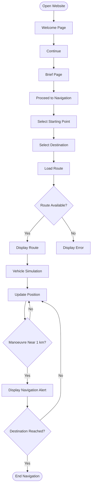

# where to PARTH — User Flow

## 1. Main Website Flow

The button labels are descriptive placeholders.

---

## 2. Page 1 — Welcome Page

Display:

> Welcome to where to PARTH - Your smarter way to navigate through Life

### Visual requirements

- F1-inspired interface.
- Two F1 cars.
- One car enters from the left.
- One car enters from the right.
- Both move diagonally across the screen simultaneously.
- Smooth and visually attractive movement.
- Welcome message remains readable.
- A clear button takes the user to the brief page.

---

## 3. Page 2 — Brief Page

Display the exact approved brief:

> Every journey deserves the right direction and every turn, the right guidance. Your destination is the goal, we'll help you find the way.
>
> Dw, Abhimanyu. This time, we'll get you out.

Do not rewrite the wording.

Provide a navigation action to continue to location selection.

---

## 4. Page 3 — Location Selection

Initial location description:

### Starting points
1. Kengeri
2. Kanakapura

### Destination
1. Somapura

The route list supplied by the team also contains other start/end directions.

Preserve all five route options until the team confirms the final selection rules.

The exact UI control (dropdown, cards or searchable selector) is TBD.

---

## 5. Page 4 — Route Display

After selecting a valid route:

1. Identify the relevant route.
2. Load the corresponding GeoJSON geometry.
3. Display the route on the map.
4. Display start and destination markers.
5. Show understandable errors if route data is unavailable.

The map-rendering library has not yet been selected.

---

## 6. Page 5 — Vehicle Simulation

The intended navigation display includes:

- Active route.
- Vehicle position.
- Starting point.
- Destination.
- Upcoming manoeuvre.
- Advance notification.

The current FastAPI endpoint returns a complete noisy trace and matched/fallback geometry in one response.

It does not currently provide streaming position updates or real-time vehicle animation.

---

## 7. Navigation Alert Flow

1. Obtain the current simulated vehicle position.
2. Relate the position to the active route.
3. Identify the next manoeuvre.
4. Calculate the remaining distance along the route.
5. Trigger an alert approximately 1 km before the manoeuvre.
6. Display a clear navigation instruction.
7. Continue until the destination is reached.

Example:

`Prepare for a left turn in 1 km.`

If lane-level map information is unavailable, display a road-level instruction instead.

Never guess a lane.

---

## 8. Route Catalogue

| Route ID | From | To | Note |
|---|---|---|---|
| R-01 | Kengeri | Kanakapura | Faster |
| R-02 | Kanakapura | Kengeri | Reverse direction |
| R-03 | Somapura | Kengeri | Supplied route |
| R-04 | Somapura | Kanakapura | Supplied route |
| R-05 | Kengeri | Kanakapura | Slower |

The two existing GeoJSON files are generic sample routes. They have not been validated as the named real-world journeys.

---

## 9. Error Handling

| Situation | Expected behaviour |
|---|---|
| Missing route file | Show route unavailable message |
| Invalid GeoJSON | Show geometry error |
| OSRM timeout | Show service error |
| OSRM returns no match | Identify no-match fallback |
| Unsupported route pair | Show unsupported route message |
| Simulation failure | Show simulation error |
| Lane data unavailable | Show road-level guidance |
| Signal-loss prediction unavailable | Do not claim it is active |

---

## 10. Interactions Yet to Be Decided

- Pause simulation.
- Resume simulation.
- Restart simulation.
- Change destination during navigation.
- Display alternative routes.
- Display estimated arrival time.
- Automatically detect destination arrival.
- Run simulation as a complete trace or incremental updates.